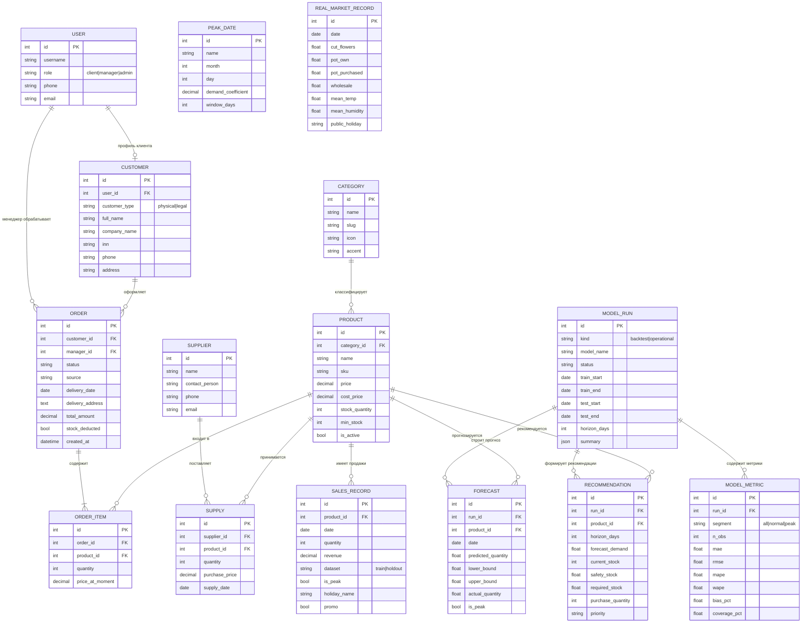

# ER-диаграмма FloraIS

## Связи и ограничения

| Связь | Кардинальность | Правило |
|-------|----------------|---------|
| User → Customer | 1 : 0..1 | клиентский профиль создаётся при регистрации |
| Customer → Order | 1 : N | заказ принадлежит одному клиенту |
| Order → OrderItem | 1 : N | позиции удаляются вместе с заказом (CASCADE) |
| Product → OrderItem | 1 : N | товар защищён от удаления (PROTECT) |
| Category → Product | 1 : N | категория защищена от удаления (PROTECT) |
| Product → Supply | 1 : N | поставка увеличивает остаток |
| Product → SalesRecord | 1 : N | уникальность `(product, date, dataset)` |
| ModelRun → Forecast | 1 : N | уникальность `(run, product, date)` |
| ModelRun → Recommendation | 1 : N | уникальность `(run, product)` |
| ModelRun → ModelMetric | 1 : N | уникальность `(run, segment)` |

## Индексы

- `Order(status, -created_at)`, `Order(created_at)`;
- `Product(is_active, category)`;
- `SalesRecord(date)`, `(dataset, date)`, `(product, dataset, date)`;
- `Forecast(run, date)`;
- `Supply(supply_date)`;
- `ModelRun(kind, -created_at)`.
